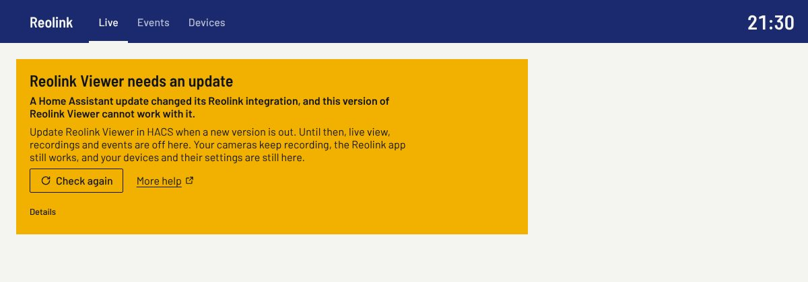
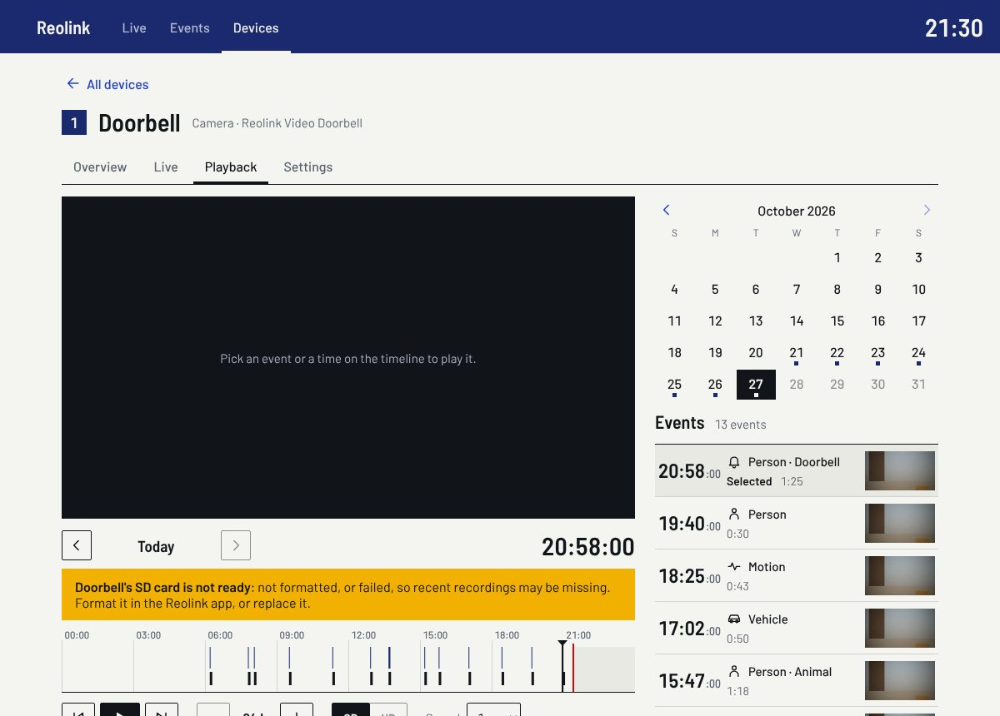

# Troubleshooting

When something goes wrong, Reolink Viewer says so in plain words and suggests a fix.
This page explains every one of its messages: what it means, and what else you can
try. Find the words you see on screen (your browser's Find, Ctrl+F or ⌘F, is
quickest), then read on from there.

Most messages have **Details** under them. That is the technical text, for when you
ask for help: you never need to open it to fix anything.

- [When Reolink Viewer cannot reach your cameras](#when-reolink-viewer-cannot-reach-your-cameras)
- [Live view](#live-view)
- [Recordings and events](#recordings-and-events)
- [Settings](#settings)
- [Checks and reports](#checks-and-reports)
- [Asking for help](#asking-for-help)

New to Reolink Viewer? The [user guide](user-guide.md) shows what each part of the
panel does. [Cameras and NVRs](cameras.md) says what to expect from each Reolink
model.

## When Reolink Viewer cannot reach your cameras

These messages fill a box at the top of every page, with a **Check again** button.
Press it once you have fixed the cause: the panel looks again and goes back to
normal.

### Reolink Viewer needs an update

> **A Home Assistant update changed its Reolink integration, and this version of
> Reolink Viewer cannot work with it.**

Reolink Viewer works through Home Assistant's own Reolink integration, and reads
parts of it that Home Assistant can change in any release. Each release of Reolink
Viewer is tested on the Home Assistant releases of its day, and a weekly check tries
each new one. When an update changes something Reolink Viewer relies on, it stops
rather than guess, and says so here.

What still works: your cameras keep recording, the Reolink app works as before, and
your devices and their settings are still on the **Devices** page. Live view,
recordings and events are off until Reolink Viewer is updated.

What to do:

1. In HACS, look for an update to Reolink Viewer. Install it and restart Home
   Assistant.
2. If there is no update yet, it is on its way: the weekly check will have caught the
   change. You can follow it, or report it, on the project's
   [issues page](https://github.com/ambient-home-systems/Maverick-Reolink-Viewer/issues).
   Copy the text under **Details** into your report.
3. Next time, before you update Home Assistant, check that Reolink Viewer's latest
   [release notes](https://github.com/ambient-home-systems/Maverick-Reolink-Viewer/releases)
   name that Home Assistant release as tested.

### The Reolink integration is not running

> **Home Assistant's Reolink integration has not loaded your cameras or NVR, so
> Reolink Viewer cannot reach them.**

Reolink Viewer has nothing to show until Home Assistant's Reolink integration has
connected to your NVR or cameras.

What to do:

1. Open Home Assistant's **Settings → Devices & services → Reolink**.
2. If an entry says **Retrying setup** or **Failed to set up**, Home Assistant cannot
   connect to that NVR or camera. The usual causes:
   - it is switched off, or unplugged from the network;
   - its address changed (give it a fixed address in your router to stop this
     happening again);
   - its password changed in the Reolink app. Choose **⋮ → Reconfigure** on the
     entry and enter the new one.
3. Once the entry says it is loaded, press **Check again** in Reolink Viewer.

### No Reolink devices yet

> **Set up your cameras or NVR in Home Assistant's Reolink integration first.**

Nothing is wrong: Home Assistant's Reolink integration has no devices yet. Add them
under **Settings → Devices & services → Add integration → Reolink**, with the NVR's or
camera's address, user name and password. An NVR brings all of its cameras with it.
They appear in Reolink Viewer once the integration has loaded them.

### A page could not load

These messages start with what could not load: "Live view", "Today's events", "This
day's events" or "Your devices".

> **…could not load: Reolink Viewer is not running.**

Reolink Viewer itself is not loaded. Open **Settings → Devices & services → Reolink
Viewer**. If it says **Failed to set up**, restart Home Assistant. If it is not listed,
add it again: **Add integration → Reolink Viewer**. Then press **Try again**.

> **…could not load: Reolink Viewer needs an update to work with this Home Assistant
> release.**

See [Reolink Viewer needs an update](#reolink-viewer-needs-an-update).

> **…could not load: Reolink Viewer was updated, but Home Assistant has not restarted
> since.**

HACS installed a new version, but Home Assistant is still running the old one.
Restart Home Assistant (**Settings → System → Restart**), then reload the page: pull
down on it in the Home Assistant app, or use your browser's reload button.

> **…could not load from Home Assistant.**

The page lost its connection to Home Assistant. Check that this device is online and
can reach Home Assistant (away from home, through Nabu Casa or your VPN), then press
**Try again**.

## Live view

### What a camera's tile says

Each camera's tile on the live board says in a word, top right, what it is doing.

| Word | What it means |
| --- | --- |
| **Live** | Live video is playing. |
| **Starting** | The video is on its way. Meanwhile, the tile shows the camera's last picture. |
| **Retrying** | The video stopped, or could not start. The tile says why, and tries again by itself. **Retry now** tries at once. |
| **Offline** | Home Assistant cannot reach the camera, since the time shown ("Offline since 21:40"). See below. |
| **Asleep** | A battery camera, left asleep to save its battery. Tap it to wake it and watch. |
| **Picture** 21:22 | A camera that keeps no recordings shows its latest picture, taken at that time. Tap it to watch live. |
| **No picture yet** | The same, before the first picture has been taken. |
| **No sub stream** | This connection to the camera cannot send that kind of video (for full screen, "No ext stream" and so on). |

An **Offline** tile says:

> **Home Assistant cannot reach this camera. It plays again when it is back.**

Nothing needs doing on the tile. Check that the camera has power and a network
connection, and whether the Reolink app can see it. A camera on an NVR shows offline
when the NVR has lost it: the NVR's channel list in the Reolink app shows which.

### Messages on a tile

A tile that says **Retrying** also says why. A small tile shows only the first
sentence: open the camera (tap the tile) to see the rest.

> **Too many cameras are streaming from this recorder at once.**

An NVR or a camera can only send so many videos at once. Reolink Viewer counts them,
so as not to overload it: 7 at once from an NVR, 2 from a camera added on its own.
Close live view on other screens (another phone, a dashboard showing a camera live,
full screen on a computer), or turn off **Keep warm** on cameras you rarely watch.

> **Live view's video service is not running.**

Reolink Viewer runs its own video service (go2rtc) inside Home Assistant to bring live
video to the panel. Restart Home Assistant. If the message comes back, run the
[live check](user-guide.md#the-live-check): its first lines say whether the service
runs. Home Assistant's log (**Settings → System → Logs**, search for "go2rtc") says
why it stopped; include those lines when you report it.

> **This browser cannot play this camera's video.**

The camera sends its video in a format this browser cannot play, usually H.265 (also
called HEVC). The live board uses each camera's smaller stream, which is H.264 on
every model tested, so this mostly happens in full screen, which shows H.265 only
where the browser says it can play it. Try Chrome, Edge or Safari, or the Home
Assistant app. Or, in the Reolink app, set the camera's video encoding to H.264, on
models that offer it.

> **The camera refused Home Assistant's login.**

The camera's password changed since Home Assistant was set up. In **Settings →
Devices & services → Reolink**, choose **⋮ → Reconfigure** on that camera's (or its
NVR's) entry, and enter the new password.

> **It could not be woken.**

A battery camera did not wake up when asked. It may be out of Wi-Fi range, or low on
battery: its **Overview** shows the battery level and Wi-Fi signal. Wait a moment and
tap it again. A doorbell on wired power does not need waking.

> **The camera did not answer.**

Home Assistant asked the camera for video and heard nothing back. Check that the
camera has power and a network connection. The tile tries again by itself, waiting a
little longer each time.

> **No connection for live video could be made from here.**

This device could not open a video connection to Home Assistant, although the page
itself works. Some networks block video connections: work, school and hotel networks,
and some VPNs. Try another network, such as mobile data. Run the
[live check](user-guide.md#the-live-check) on this device and network: it says which
way of streaming works here.

> **The camera sent no picture in time.**

The camera accepted the request but sent no video in time. It may be busy (recording,
or streaming to many viewers), or have a weak Wi-Fi signal: its **Overview** shows the
signal, where −50 dBm is strong and −70 dBm or lower is weak. The tile tries again by
itself.

> **The camera's video stopped.**

The camera ended the video, as it does when it restarts, updates its firmware or
briefly loses its network. The tile starts again by itself.

> **Live video stopped.**

Live video stopped for another reason. The tile tries again by itself. If it keeps
happening, open the tile's **ⓘ** view, press **Copy**, and include that text when
you ask for help.

In full screen, **HD cannot play:** followed by one of these messages means the HD
video could not start; full screen keeps playing the smaller stream meanwhile.

### Live view is slow to start

A camera's video can only start on a "key frame", a full picture the camera sends
every 1 to 4 seconds; the frames in between only describe what changed. So a camera
that is not kept warm takes 1 to 4 seconds to start, depending on when you open it.

- **Keep warm** (on the camera's **Live** tab) keeps its connection open and holds its
  last key frame, so its video starts in a fraction of a second. It uses one of the
  NVR's or camera's video slots all the time. Battery cameras running on their
  battery are never kept warm, to save it.
- On models that let you set it, a shorter key-frame interval for the camera's small
  ("Fluent") stream makes it start sooner. Reolink's settings call it the I-frame or
  interframe interval. In tests, a camera at 1 second started in about a second.
- Some networks, often at work, block the quicker of the panel's two ways of
  streaming (WebRTC). The first time, a camera that is not kept warm then starts
  after about 15 seconds, over the other way. The device remembers it for a week,
  for that Home Assistant address, so its cameras start the other way at once from
  then on; the camera's ⓘ view says "Network: WebRTC does not connect from here".
- The [live check](user-guide.md#the-live-check) measures how fast each camera starts
  on the device you run it on, and says what is slow.

### Live video keeps stopping on some networks

Some networks cut long video connections every few minutes. When the page sees that
happen twice, it switches its cameras to another way of streaming (WebRTC) for an
hour, which these networks leave alone. Nothing needs doing. If video still drops,
run the live check on that network, and the [soak report](user-guide.md#the-soak-report)
to see how live view holds up over a day.

### Full screen shows SD, not HD

Away from home (through Nabu Casa or Tailscale), on mobile data, or with your
device's data saver on, full screen starts in the lighter SD, and says why: "Lighter
SD through Nabu Casa. Tap HD for full quality." Tap **HD** for full quality: each
device remembers your choice. To have full screen start in HD (or SD) every time,
choose it under **Devices → This device**; there you can also stop it remembering
what you tap.

HD is the camera's full-resolution stream where this browser can play it smoothly,
and otherwise the camera's middle ("ext") stream. A Reolink Duo 3's 16-megapixel
picture is larger than most browsers can play, so its HD is its 2560×720 stream. A
battery camera added on its own has no middle stream, so where its full-resolution
stream cannot play, full screen stays in SD.

### Battery cameras and doorbells

To save their battery, battery cameras stay asleep until you tap them, are never kept
warm, and are skipped by the hardware probe unless you ask for them. A doorbell on
wired power is watched like any other camera. The
[soak report](user-guide.md#the-soak-report) checks that battery cameras slept while
nobody was watching.

### A camera is missing from the live board

Every camera Home Assistant's Reolink integration has set up appears once, numbered.
A camera on an NVR that is also added on its own appears once. If one is missing,
check that the Reolink integration lists it (**Settings → Devices & services →
Reolink**), then press **Refresh** on Reolink Viewer's **Devices** page.

## Recordings and events

Recordings play from where the camera keeps them: on its NVR, or on its own SD card.

### No recordings to play

> **…keeps no recordings: it has no SD card, and it is not on a Reolink NVR in Home
> Assistant.**

The camera does not record anywhere Reolink Viewer can play from. To record, put a
microSD card in it and format it in the Reolink app, or add it to a Reolink NVR.
Its live view and pictures work either way.

### Recordings kept where they cannot be played here

The camera records, but its NVR or SD card cannot send recordings to Home Assistant.
Play them in the Reolink app.

### Recordings cannot be played right now

Reolink Viewer cannot reach the Reolink integration: the box at the top of the page
says why, and what to do. See
[When Reolink Viewer cannot reach your cameras](#when-reolink-viewer-cannot-reach-your-cameras).

### The SD card or hard disk is not ready

> **…is not ready: not formatted, or failed, so recent recordings may be missing.**

The NVR's hard disk or the camera's SD card cannot store recordings: it is new and
not formatted yet, or it has failed. Format it in the Reolink app (this erases what is
on it), or replace it. The camera's **Overview** shows each disk's state, and the
**Playback** tab warns above the timeline.

### A day's recordings could not be read

> **[Camera] is offline, so the recordings on its SD card cannot be read.**

The recordings are on the camera's own SD card, and the camera is offline. They come
back when it does. Recordings kept on an NVR still play while a camera is offline.

> **Reolink Viewer is not running.**

Open **Settings → Devices & services → Reolink Viewer**, and restart Home Assistant if
it failed to set up. Then open the day again.

> **The recorder did not answer when asked for this day's recordings.**

The NVR or camera did not answer in time. Reading a day takes 1 to 5 seconds, longer
when the recorder is busy. Try again in a moment. If it keeps happening, check that
the NVR or camera is online, in the Reolink app.

> **The recordings could not be read.**

Something else went wrong. Try again in a moment. If it keeps happening, include the
text under **Details** when you ask for help.

### A recording could not play

> **Home Assistant's disk is too full to fetch this recording.**

To play recordings smoothly, Reolink Viewer copies each one to Home Assistant's disk
as it plays: up to 8 GB in all, removing those not played lately first, and always
leaving 2 GB of the disk free. Free some space on Home Assistant's disk (old backups are often the
largest), then play the recording again.

> **There is no HD copy of this recording.**

The recorder kept this recording in SD only. Play it in SD.

> **This recording is no longer there: the recorder may have recorded over it.**

When its disk is full, a recorder records over its oldest recordings. Open the day
again to see what is still there.

> **This recording is empty.**

The recorder has the recording, but nothing in it. Pick another event.

> **This browser cannot play this recording.**

HD recordings from some cameras are H.265 (HEVC), which some browsers cannot play. Try
Chrome, Edge or Safari, or the Home Assistant app, or play it in SD, which is H.264.

> **The recording's link has expired.**

For safety, the link to each recording works only for a short time. Play it again.

> **The recording could not be fetched.**

The page lost its connection to Home Assistant, or Home Assistant lost its connection
to the recorder. Check the connection, then play it again.

> **This recording could not play.**

Something else went wrong. Try again, or pick another event. If it keeps happening,
include the text under **Details** when you ask for help.

When HD fails during playback, the player says "HD could not play", gives the reason,
and goes back to SD.

### Events are missing

- Events come from the cameras' own detections (person, vehicle, animal, face,
  package, a doorbell press) and motion, as the recorder saved them. A camera that
  keeps no recordings has no events.
- New events appear in the board's **Today** list within 2 minutes.
- In the calendar, a dot marks each day with recordings.
- A detection the camera does not offer (a camera without AI detection has motion
  only) never appears. A camera's **Overview** lists its AI detection.

## Settings

- **A setting is missing.** Home Assistant's Reolink integration creates some
  settings switched off (disabled). An administrator can tick **Show disabled
  entities** on a camera's **Settings** tab and turn one on. Home Assistant then
  reloads the Reolink integration, which takes about half a minute.
- **A change does not stick.** Settings change through Home Assistant's Reolink
  integration, and the panel always shows what the camera reports. If a value springs
  back, the camera refused it, or another app (the Reolink app, an automation)
  changed it again.
- **"Asks first"** marks settings that interrupt the camera (a restart, the siren,
  recording off): the panel asks before changing them.
- **"Read only"** marks values the camera reports but cannot be changed, such as its
  Wi-Fi signal.
- A camera that is on an NVR and also added on its own has two sets of settings,
  **Through NVR** and **Added directly**. Both reach the same camera: a change made
  through either applies to it.

## Checks and reports

The live check, the playback check and the soak report say first, in a headline, how
things went. Each line under it starts with a word:

| Word | Means |
| --- | --- |
| **Good** | as it should be |
| **Fine** | a little slower, nothing to do |
| **Slow** | works, but worth a look |
| **Problem** | something is wrong |
| **Note** | for your information |
| **Not yet** | still to come |

A **Slow** or **Problem** line says what to do about it. Under **Details** (or
**Details for support**) are the measurements, with a **Copy** button for your report.
How to run each check is in the [user guide](user-guide.md#checks).

## Asking for help

Before asking:

1. Update Reolink Viewer to its newest release (HACS shows it), and restart Home
   Assistant.
2. Run the [live check](user-guide.md#the-live-check) for live view problems, or the
   [playback check](user-guide.md#the-playback-check) for recordings.

Then open an issue on the project's
[issues page](https://github.com/ambient-home-systems/Maverick-Reolink-Viewer/issues),
with:

- Reolink Viewer's version (the **Help** section of the **Devices** page shows it)
  and Home Assistant's (**Settings → About**);
- the camera or NVR model and its firmware (its **Overview**);
- the device and network you watched from ("iPhone app through Nabu Casa");
- the message you saw, and the text under its **Details**;
- for live view, the tile's **ⓘ** view: press **Copy** and paste it;
- the check's report: press its **Copy** button and paste it;
- for a problem with a camera model, the hardware probe's file (administrators:
  **Devices → Hardware probe → Run probe**). The probe only reads from your cameras,
  and leaves passwords, addresses, serial numbers and other private details out of
  the file.
