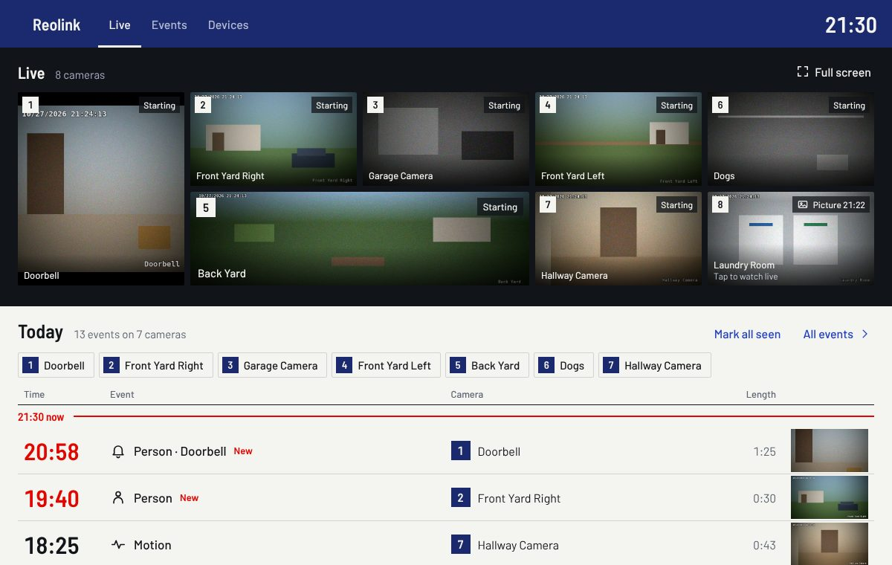
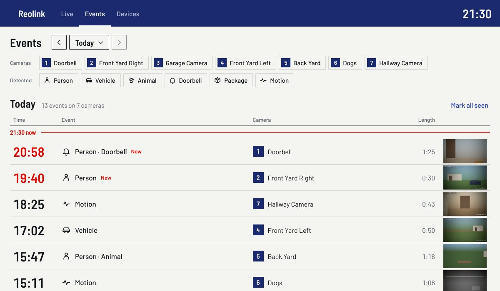
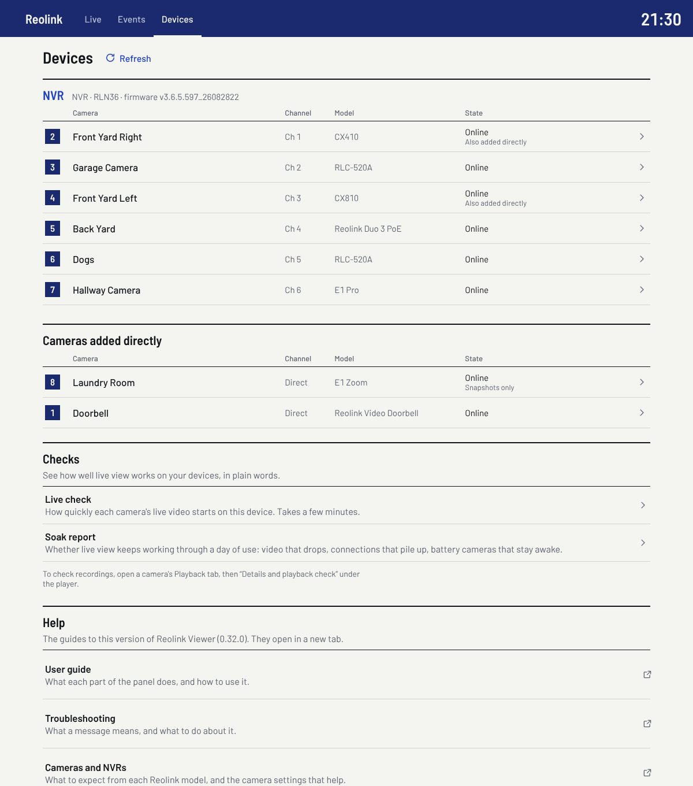
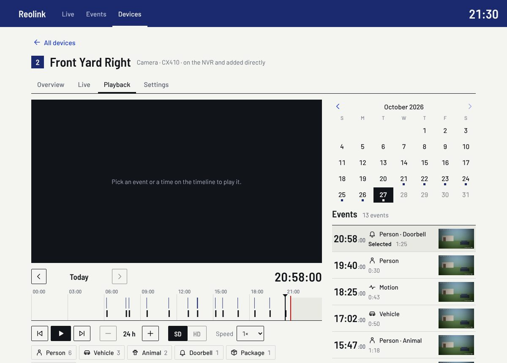
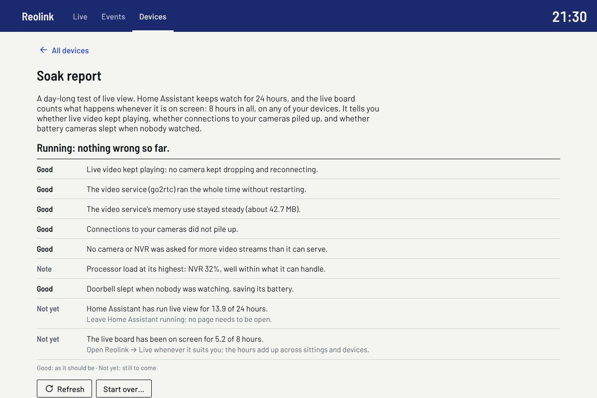
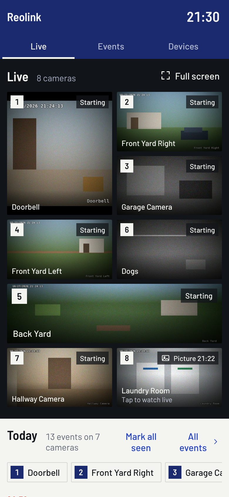

# User guide

Reolink Viewer adds a **Reolink** panel to Home Assistant's sidebar. In it you can
watch your Reolink cameras live, see what they detected, play back what they
recorded, and read and change every setting Home Assistant's Reolink integration
offers, each one explained.

It works through the Reolink integration that comes with Home Assistant: it adds no
accounts and no passwords of its own, and needs no cloud service.

The pictures in this guide show the panel with sample cameras.

- [Before you start](#before-you-start)
- [Install](#install)
- [Live](#live)
- [Events](#events)
- [Devices](#devices)
- [A camera's page](#a-cameras-page)
- [Checks](#checks)
- [On a phone](#on-a-phone)
- [From the keyboard](#from-the-keyboard)
- [Your privacy](#your-privacy)
- [Updating and removing](#updating-and-removing)

When something does not work, [Troubleshooting](troubleshooting.md) explains every
message the panel shows. [Cameras and NVRs](cameras.md) says what to expect from each
Reolink model.

## Before you start

You need:

- **Home Assistant 2026.10.1 or newer.**
- **Your Reolink devices set up in Home Assistant's Reolink integration** (Settings →
  Devices & services → Add integration → Reolink). Add an NVR or Home Hub and its
  cameras come with it; add cameras that are not on one each on their own.
- **[HACS](https://hacs.xyz)**, to install Reolink Viewer and be told about updates.
  You can also install it by hand, without HACS.

## Install

With HACS:

1. In HACS, open the **⋮** menu → **Custom repositories**. Add
   `https://github.com/ambient-home-systems/Maverick-Reolink-Viewer`, type
   **Integration**.
2. Find **Reolink Viewer** in HACS, choose **Download**, then restart Home Assistant
   (Settings → System → Restart).
3. Go to Settings → Devices & services → **Add integration**, and choose **Reolink
   Viewer**. There is nothing to fill in.

By hand: download `reolink_viewer.zip` from the
[latest release](https://github.com/ambient-home-systems/Maverick-Reolink-Viewer/releases/latest),
unzip it into a new folder `config/custom_components/reolink_viewer` in Home
Assistant, restart Home Assistant, then do step 3.

**Reolink** now appears in the sidebar. It opens on **Live**. The blue band at the
top has three tabs, **Live**, **Events** and **Devices**, and the time.

## Live

### The board

Every camera is on the board, numbered. The numbers stay the same everywhere in the
panel, so "3" is always the same camera. Each tile is shaped like its camera's
picture: a square doorbell takes two rows, a wide panoramic camera takes two columns.

A tile starts from the camera's last picture, then fades into live video, usually
within a second or two. Top right, a word says what it is doing: **Live**,
**Starting**, **Retrying**, **Offline** or **Asleep**. When it cannot play, it says
why, in a sentence, and what to do.
[Troubleshooting](troubleshooting.md#what-a-cameras-tile-says) lists every word and
message.

- **Tap a tile** to open that camera's own page, at its **Live** tab.
- **Full screen** (top right of the board) fills the screen with the whole board.
- Off screen, or when you switch to another app, the board pauses its video, and
  starts it again when you come back.

Some cameras wait for a tap:

- **Battery cameras** stay asleep, to save their battery: tap one to wake it and
  watch. A battery doorbell on wired power plays like any other camera.
- **Cameras that keep no recordings** (no SD card, not on an NVR) show their latest
  picture and the time it was taken ("Picture 21:22"): tap one to watch it live.

### A camera full screen

Each tile has small buttons, bottom right:

- **Full screen** shows that camera alone, in HD. The HD video starts in the
  background and replaces the smaller picture as soon as it plays. Away from home or
  on mobile data, full screen starts in the lighter SD instead, to save data: tap
  **HD** for full quality, and each device remembers your choice.
- **Picture in picture** keeps the camera playing in a small window over your other
  windows and apps, where your browser offers it.
- **ⓘ** shows what the tile plays and how, for when you ask for help. Its **Copy**
  button copies it all.

Press **Esc**, or the full-screen button again, to leave full screen.

### The camera's controls

On a camera's **Live** tab and in full screen, the camera's own controls sit over its
video, for the cameras that have them:

- **Pan and tilt**: hold an arrow to move the camera, let go to stop.
- **Zoom** and **focus**: − and +.
- **Preset…**: move to a position saved in the Reolink app.
- **Light**: the floodlight, on or off.
- **Siren**: asks first ("Sound the siren on Front Door?"), then sounds until you
  press **Stop siren**.

They work through Home Assistant's own Reolink controls, so automations and the rest
of Home Assistant see each change.

### Keep warm

**Keep warm**, on a camera's **Live** tab, keeps its connection open all the time, so
its video starts in a fraction of a second instead of 1 to 4 seconds. It is on for
most cameras, as many as each NVR or camera can serve while leaving room for one HD
view, but not for cameras that keep no recordings. Each camera kept warm uses one of
its NVR's or its own video slots all the time, so turn it off for cameras you rarely
watch. Battery cameras running on their battery are never kept warm.

Keep warm is also a switch in Home Assistant ("Front Door keep live view warm"), so
you can change it from automations and dashboards.

### Today's events

Under the board, today's events from every camera are listed newest first, under a
red line at the time now. Each row has the time, what was seen (person, vehicle,
animal, face, package, a doorbell press, motion), the camera's number and name, how
long it lasted, and a picture.

- **Tap a row** to play that recording, on the camera's **Playback** tab.
- An event you have not opened yet is marked **New**, in red. Each Home Assistant
  user has their own marks: opening an event clears it for you, not for others.
  **Mark all seen** clears them all.
- The camera buttons above the list show only those cameras' events.
- **All events** opens the **Events** tab.

## Events

The **Events** tab lists any day's events from every camera, like today's under the
board.

- **‹** and **›** go to the day before and after. The day's name opens a calendar,
  where a dot marks each day with recordings.
- **Cameras** and **Detected** narrow the list to some cameras, or to what was seen
  (person, vehicle, animal, doorbell, package, motion). Tap a button again to show all.
- Tap a row to play its recording.

## Devices

The **Devices** tab lists your NVRs and Home Hubs with their cameras, then the
cameras added on their own. Each row has the camera's number on the board, its
channel, model and state. "Also added directly" marks a camera that is in Home
Assistant both through its NVR and on its own: the panel shows it once. "Snapshots
only" marks a camera that keeps no recordings.

Below the list:

- **Checks**: the [live check](#the-live-check) and the
  [soak report](#the-soak-report).
- **Help**: this guide, [Troubleshooting](troubleshooting.md) and
  [Cameras and NVRs](cameras.md), for the version you have installed (it says which).
- **Hardware probe**, for administrators: see [below](#the-hardware-probe).

**Refresh** reads your devices again, after you add or change one in Home Assistant.

## A camera's page

Tap a camera in the **Devices** list, or a tile on the board, to open its page. It has
four tabs: **Overview**, **Live**, **Playback** and **Settings**. An NVR's page lists
its cameras and its own details and settings.

### Overview

The camera's latest snapshot (**Refresh** takes a new one), and its details: model,
firmware, whether it is online, its two video streams (Reolink calls them **Clear**,
the full resolution, and **Fluent**, the small one), its network (Wi-Fi with its
signal strength, or Ethernet), its storage, its battery, and which AI detections it
has. A camera both on an NVR and added on its own shows both connections side by
side.

A box warns when an SD card or hard disk is not ready to record.

### Live

The camera live, larger, with its [controls](#the-cameras-controls) and the
[Keep warm](#keep-warm) switch.

### Playback

The camera's recordings, from its NVR or its own SD card.

- **Pick a day** in the calendar (a dot marks each day with recordings), or with
  **‹** and **›** under the player.
- **Pick an event** in the list beside it, or **click the timeline** at any time, to
  play from there. The large clock shows the time playing.
- The **timeline** shows the day's recordings as a band, and each event as a mark.
  **−** and **+** zoom from the whole day to 5 minutes. Drag along it to look through
  the recording; on a computer, hovering over it shows the picture at that time.
- **⏮ ▶ ⏭**: the previous event, play or pause, the next event. At the end of a
  recording, the next one plays by itself.
- **SD / HD**: switch quality; playback carries on from the same moment. HD may take
  a few seconds to start: the recorder sends the full-quality recording first.
- **Speed**: from half speed to 8 times.
- The buttons under the timeline (**Person 6**, **Vehicle 3**, …) show only those
  events, with how many there were.
- **Picture in picture** keeps the recording playing in a small window.

A camera with no recordings to play says why, and what to do.

### Settings

Every setting the Reolink integration offers for the camera, grouped (detection,
image, lights, streams, recording, notifications, audio, siren, system), each with a
line saying what it does. **About this setting** opens a fuller explanation.

- **Search settings** finds one by name.
- Settings marked **Asks first** interrupt the camera (restart it, sound the siren,
  stop recording): the panel asks before changing them.
- **Read only** marks what the camera reports but you cannot change.
- A camera both on an NVR and added on its own has two sets of settings, **Through
  NVR** and **Added directly**. Both reach the same camera: a change made through
  either applies to it.
- Administrators can tick **Show disabled entities** to see, and turn on, settings
  Home Assistant's Reolink integration keeps switched off.

Every change goes through Home Assistant, as if made on a Home Assistant dashboard,
and the panel always shows what the camera reports back.

## Checks

The checks test how well Reolink Viewer works on your cameras and your devices, and
say so in plain words: a headline, then a line for each camera or part, marked
**Good**, **Fine**, **Slow** or **Problem**, with what to do about anything slow or
wrong. The full measurements are underneath, with a **Copy** button for when you ask
for help. None of them changes a camera setting.

### The live check

**Devices → Live check.** How quickly each camera's live video starts on this device,
on this network.

1. Choose **This device and network** (say, "iPhone app, Nabu Casa"), and the cameras.
2. Press **Run live check**. It plays each camera in turn for a few seconds, so it
   takes a few minutes: keep the page open and in front.

Run it on each device you use, at home and away, and compare. Each run is saved
(**Saved reports**), so you can read it later on any device. Administrators can add
the **NVR capacity test**, which finds how many videos each NVR serves at once (at
home only).

### The playback check

**A camera's Playback tab → Details and playback check → Run playback check.** How
well recordings play on this device: how fast they start, seek and change speed, and,
if you tick them, switching to HD and back, and playing on for a few minutes.

### The soak report

**Devices → Soak report.** Whether live view keeps working through a day: video that
drops, connections that pile up, battery cameras that stay awake. Home Assistant
keeps watch for 24 hours, with no page open; and the board counts what happens
whenever it is on screen, 8 hours in all, across any devices and sittings. Open it
any time to see how it is going; **Start over…** begins a new day.

### The hardware probe

**Devices → Hardware probe**, for administrators. It tests which ways of getting live
and recorded video work on each of your cameras, and how fast. Run it when you report
a problem with a camera model: it makes a file to attach to your report. It only reads
from your cameras, and leaves passwords, addresses, serial numbers and other private
details out of the file. Battery cameras are left out unless you tick them, since the
test wakes them.

## On a phone

The panel works in the Home Assistant app on a phone (it is tested on iPhone), and in
a phone's browser. On a narrow screen:

- the board shows two cameras per row, and today's events stack under it;
- on the **Playback** timeline, **pinch** to zoom in on a moment, and **slide two
  fingers** to move along the day;
- **picture in picture** keeps a camera or recording playing over your other apps;
- away from home or on mobile data, full screen starts in the lighter SD; tap **HD**
  for full quality.

## From the keyboard

Everything works from the keyboard, and with a screen reader.

- **Tab** moves from control to control; **Enter** or **Space** presses one.
- **The timeline** is a slider: **←** and **→** move the time (a step suited to the
  zoom), **Page Up** and **Page Down** six steps, **Home** and **End** the day's start
  and end. The recording plays from there when you stop, or at once with **Enter**.
  **+** and **−** zoom.
- **The calendar**: the arrow keys move by day and week, **Home** and **End** to the
  week's start and end, **Page Up** and **Page Down** by month.
- **A camera's tabs**: **←** and **→** move between Overview, Live, Playback and
  Settings.
- **Esc** leaves full screen and closes questions such as the siren's.

When your device asks for less motion, the panel stops its fades and movement.

## Your privacy

- Your cameras' addresses and passwords stay in Home Assistant: the panel never sees
  them. Video reaches it through Home Assistant, with your Home Assistant login, and
  links to recordings work only for a short time.
- Reolink Viewer has no cloud service or account of its own. Away from home, video
  goes through however you already reach Home Assistant (Nabu Casa, a VPN), with the
  same connection helpers as Home Assistant's own camera view.
- Live video goes through a video service (go2rtc) that Reolink Viewer runs inside
  Home Assistant. Where Home Assistant has no copy of it, Reolink Viewer downloads one
  fixed version from go2rtc's releases on GitHub, once, and checks it before use.
- Settings change only through Home Assistant, like a change on any Home Assistant
  dashboard.
- To play recordings smoothly, it keeps copies of recently played recordings on Home
  Assistant's disk, up to 8 GB, removing the oldest as it goes.

## Updating and removing

HACS shows each new release of Reolink Viewer as an update. Install it, then restart
Home Assistant. What each release brings is in the
[changelog](../CHANGELOG.md). Before updating Home Assistant itself, check that
Reolink Viewer's newest release notes name that Home Assistant release as tested.

To remove it: Settings → Devices & services → **Reolink Viewer** → **⋮ → Delete**,
then remove it in HACS and restart Home Assistant. Your cameras, the Reolink
integration and its settings are not touched.
