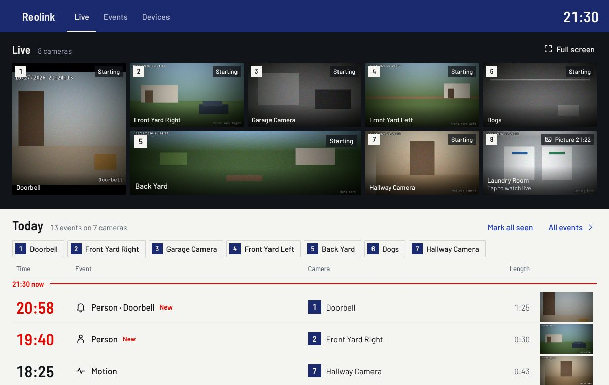
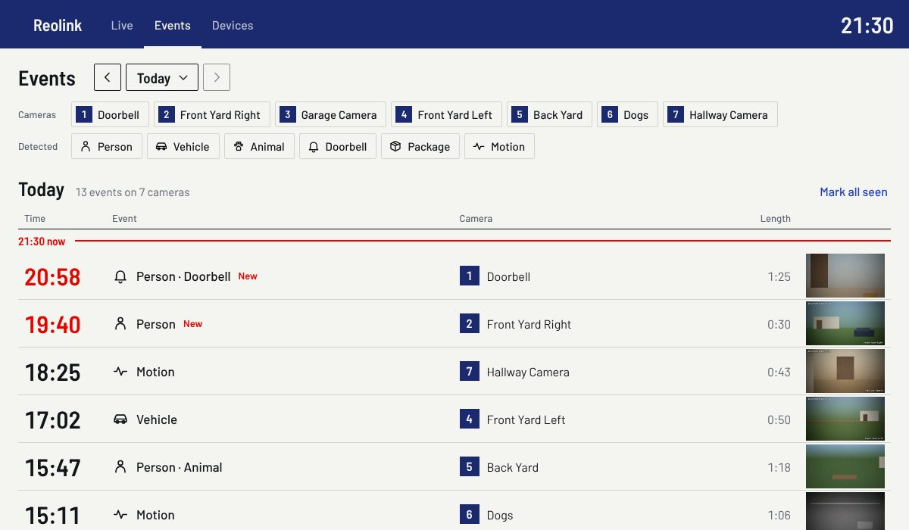
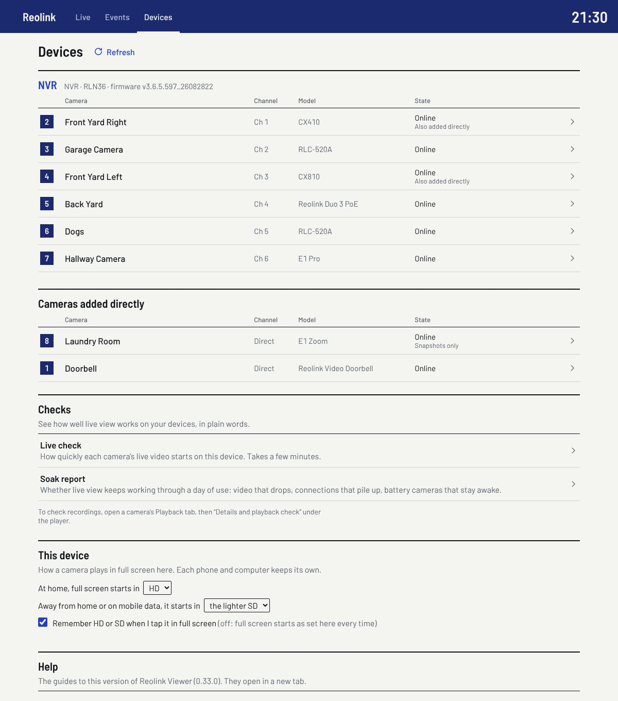
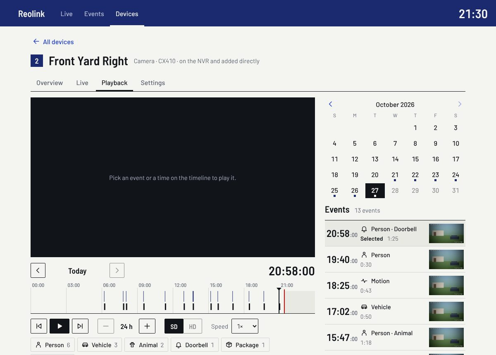
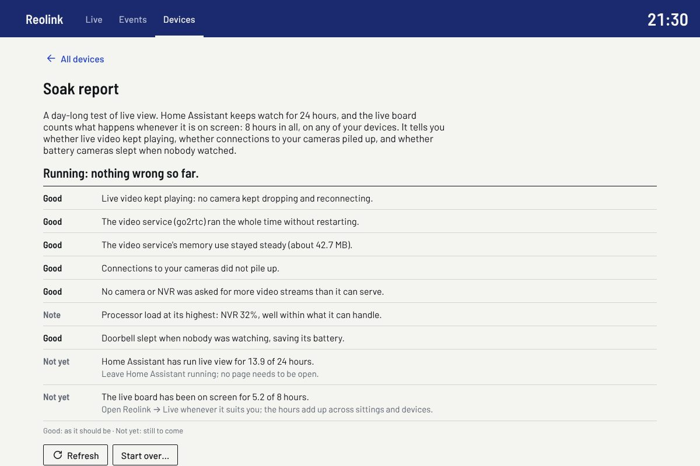
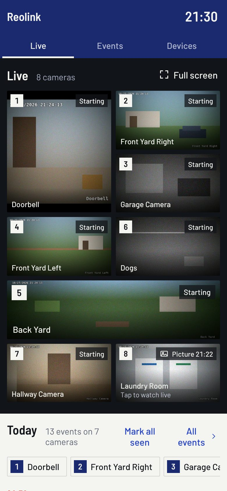

# User guide

Reolink Viewer adds a **Reolink** panel to Home Assistant's sidebar. In it you can
watch your Reolink cameras live, see what they detected, play back what they
recorded, and read and change every setting Home Assistant's Reolink integration
offers, each one explained.

It works through the Reolink integration that comes with Home Assistant: it adds no
accounts and no passwords of its own, and needs no cloud service.



The pictures in this guide show the panel with sample cameras.

- [Before you start](#before-you-start)
- [Install](#install)
- [Live](#live)
- [Events](#events)
- [Devices](#devices)
- [A camera's page](#a-cameras-page)
- [A camera on a dashboard](#a-camera-on-a-dashboard)
- [Checks](#checks)
- [On a phone](#on-a-phone)
- [From the keyboard](#from-the-keyboard)
- [Your privacy](#your-privacy)
- [Updating and removing](#updating-and-removing)

When something does not work, [Troubleshooting](troubleshooting.md) explains every
message the panel shows. [Cameras and NVRs](cameras.md) says what to expect from each
Reolink model.

## Before you start

You need:

- **Home Assistant 2026.10.1 or newer.**
- **Your Reolink devices set up in Home Assistant's Reolink integration** (Settings →
  Devices & services → Add integration → Reolink). Add an NVR or Home Hub and its
  cameras come with it; add cameras that are not on one each on their own.
- **[HACS](https://hacs.xyz)**, to install Reolink Viewer and be told about updates.
  You can also install it by hand, without HACS.

## Install

With HACS:

1. In HACS, open the **⋮** menu → **Custom repositories**. Add
   `https://github.com/ambient-home-systems/Maverick-Reolink-Viewer`, type
   **Integration**.
2. Find **Reolink Viewer** in HACS, choose **Download**, then restart Home Assistant
   (Settings → System → Restart).
3. Go to Settings → Devices & services → **Add integration**, and choose **Reolink
   Viewer**. There is nothing to fill in.

By hand: download `reolink_viewer.zip` from the
[latest release](https://github.com/ambient-home-systems/Maverick-Reolink-Viewer/releases/latest),
unzip it into a new folder `config/custom_components/reolink_viewer` in Home
Assistant, restart Home Assistant, then do step 3.

**Reolink** now appears in the sidebar. It opens on **Live**. The blue band at the
top has three tabs, **Live**, **Events** and **Devices**, and the time.

## Live

### The board

Every camera is on the board, numbered. The numbers stay the same everywhere in the
panel, so "3" is always the same camera. Each tile is shaped like its camera's
picture: a square doorbell takes two rows, a wide panoramic camera takes two columns.

A tile starts from the camera's last picture, then fades into live video, usually
within a second or two. Top right, a word says what it is doing: **Live**,
**Starting**, **Retrying**, **Offline** or **Asleep**. When it cannot play, it says
why, in a sentence, and what to do.
[Troubleshooting](troubleshooting.md#what-a-cameras-tile-says) lists every word and
message.

- **Tap a tile** to open that camera's own page, at its **Live** tab.
- **Full screen** (top right of the board) fills the screen with the whole board.
- Off screen, or when you switch to another app, the board pauses its video, and
  starts it again when you come back.

Some cameras wait for a tap:

- **Battery cameras** stay asleep, to save their battery: tap one to wake it and
  watch. A battery doorbell on wired power plays like any other camera.
- **Cameras that keep no recordings** (no SD card, not on an NVR) show their latest
  picture and the time it was taken ("Picture 21:22"): tap one to watch it live.

### The Wall

**Wall**, top right of the board, shows the cameras' video only, large, fitted to the
screen with nothing to scroll, like an NVR's monitor: for a wall tablet, a second
screen, or a quiet look at everything. A thin bar along the top holds the layout, the
time, **Full screen** and **Board** (back to the board).

- **Layouts:** **All cameras** packs every camera by its shape, as the board does, in
  as many columns as show each picture largest. A saved layout can be **1**, **2 × 2**,
  **3 × 3**, **4 × 4**, or one large camera with five or seven around it (**1 + 5**,
  **1 + 7**). A camera's picture is never cropped at its sides.
- **Layout ⌄** names a layout and picks its grid; the screen shows it as you choose.
  **Save** keeps it; **Save as new** keeps a copy; **Delete** removes it.
- **Show**, in **Layout ⌄**: untick **Floodlight buttons** or **Siren buttons** to
  leave those buttons off every feed of the layout (a wall tablet nobody should set
  the siren off from), and **Latest detections** to leave out the strip. The camera's
  other controls stay. **All cameras** shows them all.
- **Layouts are yours:** saved on this Home Assistant for your user, so the wall
  tablet signed in as you shows the ones made on your desktop.
- **Each device remembers** whether it shows the board or the Wall, and which layout:
  the wall tablet opens on the Wall, the desktop on the board.
- **A layout's address** opens it directly, for a kiosk's start page: the panel's
  address followed by `#wall/` and the layout's name in lower case, with dashes for
  spaces (`#wall/front-of-the-house`); the editor shows it.

Arranging:

- **Move a camera:** drag its tile onto another, and the two swap. On a touch screen,
  tap **Arrange** in the bar, tap a camera, then where it goes (an empty cell too);
  tap **Arrange** again when done. A saved layout keeps the new order at once, for
  every device; **All cameras** keeps it until you leave, so save it as a layout to
  keep it.
- **Make one larger:** double-tap a tile. In **1 + 5** and **1 + 7** it goes into the
  large slot; in any other grid it fills the screen alone, until another double tap,
  **Esc** or **Back to the layout**.
- **Pages:** a layout with more cameras than cells has pages: **‹ 1 / 2 ›** in the bar.
- **A tour:** **Tour** in **Layout ⌄** turns the pages by itself, every 10 seconds to
  every 2 minutes. It pauses while you arrange or edit, or watch one camera alone.

From the keyboard: **Tab** reaches the cells, the **arrow keys** move between them,
**Shift** with an arrow moves the camera, **Enter** makes it larger, **Esc** brings it
back, and **Page Down** and **Page Up** turn pages. A screen reader is told each move.

HD in large tiles:

- **The large tile plays in HD:** the large slot of **1 + 5** and **1 + 7**, a camera
  alone on the screen, and any tile shown larger than the camera's lighter SD
  picture. Its tile says **Live HD**. As in full screen, the SD video plays until the
  HD video has its first picture, so nothing goes blank.
- **Two at a time per NVR:** an NVR plays two HD tiles at once (a camera added
  directly, one of its own), the large slot first. The other tiles stay in SD; their
  **ⓘ** says why.
- **It gives way:** HD in a tile takes a stream from the NVR only when one is free,
  and gives it back as soon as anything else needs it (another screen, full screen, a
  recording): the tile goes back to SD for a minute, then tries again.
- **Away from home**, the tiles stay in SD, as full screen does, unless you chose HD
  on this device.

The latest detections:

- **A tile lights up** with a red frame and what its camera sees (**Person**,
  **Vehicle**…) the moment one of its detection sensors turns on in Home Assistant,
  until it turns off.
- **The strip along the bottom** holds each camera's newest detection, newest first:
  a picture from the recording, what and when, the camera, **New** in red until you
  open it, and **Unusual** when it stood out (see
  [Learning what is normal](#learning-what-is-normal)). Today's, or the newest the
  camera saw on an earlier day. Tap one to open its recording.
- **A detection going on** comes first as **Now**, with the camera's latest picture;
  tap it to see the camera large. Once it ends, the strip asks the camera again, and
  its recording takes the card's place.

As a kiosk (a wall tablet, or a second screen):

- **The pointer hides** after 3 seconds still, and shows again when it moves.
- **The screen stays awake** while the Wall shows, where the browser can keep it so
  (Chrome, Edge and Safari, on a page opened over https; not over plain http). In
  Fully Kiosk, Fully's own **Keep Screen On** and screensaver settings do it.
- **In Fully Kiosk,** with its JavaScript interface on (see
  [A camera on a dashboard](#a-camera-on-a-dashboard)), the Wall's video stops while
  Fully's screen is off or its screensaver shows, and starts again after.

### A camera full screen

Each tile has small buttons, bottom right:

- **Full screen** shows that camera alone, in HD. The HD video starts in the
  background and replaces the smaller picture as soon as it plays. Away from home or
  on mobile data, full screen starts in the lighter SD instead, to save data: tap
  **HD** for full quality, and each device remembers your choice. To choose how it
  starts, see [This device](#this-device).
- **Picture in picture** keeps the camera playing in a small window over your other
  windows and apps, where your browser offers it.
- **ⓘ** shows what the tile plays and how, for when you ask for help. Its **Copy**
  button copies it all.

Press **Esc**, or the full-screen button again, to leave full screen.

**Zoom in** on any part of the picture in full screen, as on a recording (see
[Zoom into the picture](#zoom-into-the-picture)).

### The camera's controls

On a camera's **Live** tab and in full screen, the camera's own controls sit over its
video, for the cameras that have them:

- **Pan and tilt**: hold an arrow to move the camera, let go to stop.
- **Zoom** and **focus**: − and +.
- **Preset…**: move to a position saved in the Reolink app.
- **Light**: the floodlight, on or off.
- **Siren**: asks first ("Sound the siren on Front Door?"), then sounds until you
  press **Stop siren**.

They work through Home Assistant's own Reolink controls, so automations and the rest
of Home Assistant see each change.

### Keep warm

**Keep warm**, on a camera's **Live** tab, keeps its connection open all the time, so
its video starts in a fraction of a second instead of 1 to 4 seconds. It is on for
most cameras, as many as each NVR or camera can serve while leaving room for one HD
view, but not for cameras that keep no recordings. Each camera kept warm uses one of
its NVR's or its own video slots all the time, so turn it off for cameras you rarely
watch. Battery cameras running on their battery are never kept warm.

Keep warm is also a switch in Home Assistant ("Front Door keep live view warm"), so
you can change it from automations and dashboards.

### Today's events

Under the board, today's events from every camera are listed newest first, under a
red line at the time now. Each row has the time, what was seen (person, vehicle,
animal, face, package, a doorbell press, motion), the camera's number and name, how
long it lasted, and a picture.

- **Tap a row** to play that recording, on the camera's **Playback** tab.
- An event you have not opened yet is marked **New**, in red. Each Home Assistant
  user has their own marks: opening an event clears it for you, not for others.
  **Mark all seen** clears them all.
- The camera buttons above the list show only those cameras' events.
- **All events** opens the **Events** tab.

## Events



The **Events** tab lists any day's events from every camera, like today's under the
board.

- **‹** and **›** go to the day before and after. The day's name opens a calendar,
  where a dot marks each day with recordings.
- **Cameras** and **Detected** narrow the list to some cameras, or to what was seen
  (person, vehicle, animal, doorbell, package, motion). Tap a button again to show all.
- Tap a row to play its recording.

A battery doorbell that keeps its recordings on its own SD card lists its events
too, while it runs on wired power. Its recordings cannot be played in the panel yet:
tapping one of its rows opens its **Playback** tab on that event, with pictures from it
(one every 5 seconds) and the day's other events beside them. Play the recordings
themselves in the Reolink app.

## Devices



The **Devices** tab lists your NVRs and Home Hubs with their cameras, then the
cameras added on their own. Each row has the camera's number on the board, its
channel, model and state. "Also added directly" marks a camera that is in Home
Assistant both through its NVR and on its own: the panel shows it once. "Snapshots
only" marks a camera that keeps no recordings.

Below the list:

- **Checks**: the [live check](#the-live-check), the
  [soak report](#the-soak-report) and the
  [dashboard cards report](#the-dashboard-cards-report).
- **Learning what is normal**: whether Reolink Viewer keeps a journal of what each
  camera detects, and what it marks as unusual, [below](#learning-what-is-normal).
- **This device**: how full screen plays on the phone or computer you are using,
  [below](#this-device).
- **Help**: this guide, [Troubleshooting](troubleshooting.md) and
  [Cameras and NVRs](cameras.md), for the version you have installed (it says which).
- **Hardware probe**, for administrators: see [below](#the-hardware-probe).

**Refresh** reads your devices again, after you add or change one in Home Assistant.

### Learning what is normal

Of the hundreds of detections a day, a few are unusual for their camera: a person at
the back door at 3 am, a car in the drive in the middle of a weekday. Reolink Viewer
learns what is normal for each camera and marks what is not. To learn, it keeps a
journal of what each camera detects (people, vehicles, animals, motion, doorbell
presses and the rest of the Reolink integration's detection sensors) and when.

- **Off unless you turn it on:** **Settings → Devices & services → Reolink Viewer →
  Configure → Learn what is normal.**
- **It stays on this Home Assistant:** the journal is a file in the config folder,
  `reolink_viewer_journal.db`, included in Home Assistant's backups and never sent
  anywhere. It shows when your cameras see people, and so when the house is empty:
  turning the option off deletes it, and so does removing Reolink Viewer.
- **A head start:** it begins with the last 10 days of Home Assistant's own history
  of these sensors.
- **Motion as bursts:** a motion sensor that goes off and back on within 30 seconds
  (a tree in the wind, passing headlights) is one burst of motion, from its first
  start to its last stop. People, vehicles, animals, doorbell presses and the other
  detections are kept as they come.
- **A year:** what is older than 12 months is deleted, each day.
- **Small:** a few megabytes a month for a busy property.
- **On the Devices page,** **Learning what is normal** says since when it learns, how
  many detections it has from each camera, and whether each camera marks what is
  unusual yet.

#### What is unusual

It counts rather than recognises. Per camera, and per kind of thing seen (a person, a
vehicle, an animal, motion, a doorbell press...), it learns how often it happens at
each time of day, how long after sunset, for how long, on which days of the week, and
which camera saw something just before. An event whose combination is rare for its
camera is unusual: the cat that crosses the drive every night at 1 am is normal there;
a person doing the same is not. Recent weeks count most (a 90-day half-life), so it
follows a household that changes.

- **A camera marks once it has a week of history and 200 detections.** Until then the
  Devices page says what it is short of ("Learning: 3 more days").
- **Motion is learned from, never marked.** It still tells the model what fired
  first and what a camera usually sees; the marks go to people, vehicles, animals,
  doorbell presses and the like.
- **One thing on several cameras is one mark:** the same kind of thing seen on
  several cameras within a minute, such as an animal crossing the front of the house,
  is marked once, naming every camera that saw it.
- **Only lasting longer than usual stands out.** Someone lingering is worth a look;
  a detection briefer than usual (a passing car, a false one) is not.
- **Whatever a camera has seen 10 times is known there:** a kind, a time of day, a
  length, a day of the week. It no longer makes an event stand out (the doorbell on
  the doorbell camera, the car that arrives most evenings), so a mark says "seen
  twice", "seen 7 times", never many more: how many times the camera has seen that,
  this time included.
- **What fired just before** means another camera's detection (a person, vehicle,
  animal...), not its motion; and only **nothing firing first**, where something
  usually does, makes an event stand out.
- **On the timetable** (the home view and Events), a marked event has a plain
  **Unusual** tag. **Why it is unusual**, under the row, opens its sentence and each
  signal: what it was, and whether it made the event rarer than chance or more usual,
  with a bar for how much. The row itself still opens the recording.
- **Events → Marked: Unusual** shows only the marked events of the day. It reads
  **Learning…** until a camera has learned enough to mark.
- **What it has learned**, on each camera's Overview: per kind of thing it sees, when
  (each hour of the day), on which days, for how long and what fired first. A value it
  has seen fewer times than it takes to know it says **Can stand out**. It is the way
  to spot a camera that learned something wrong: a spider on the lens every night is
  normal to it after ten nights or so.
- **A marked event the camera does not list** (a camera whose recordings cannot be
  searched, or an event its list has not caught up with) still gets a row, "seen by
  Home Assistant's sensors".
- **Unusual in the last 7 days**, on the Devices page: how many were marked, about how
  many a day, and the latest, each with a sentence saying why: "Person at 03:12 on
  Doorbell — seen twice in 3 weeks, and nothing fired first." **The numbers behind it**
  show how the line was drawn, and what stood out most in the marks.
- **How much to mark unusual** (in the options): **Only the strangest** (under one a
  day), **Balanced** (the default: a few a day at most, fewer on a quiet property) or
  **More, including borderline ones** (about 6 a day at most, counting as new what a
  camera has seen fewer than 20 times rather than 10).
- **House-wide signals to learn with** (in the options, optional): states from
  around the house that say something a camera cannot, such as anyone home, the
  alarm, a gate or door lock, the camera's day/night state or the light outside.
  Each detection is learned with what they stood at, so a person on the drive with
  everyone away can stand out where the same person with someone home does not, and
  a mark says so: "…, and with House alarm armed away". Their last days come from
  Home Assistant's history; a signal that is offline or starting up says nothing.
  The cameras' own detection sensors, and equipment reporting on itself (batteries,
  connectivity, diagnostics), are not offered. They are kept in the same journal
  file, on this Home Assistant.
- **What each camera is compared with** (in the options): every camera is judged
  against its own past first; this decides what a camera with little history may
  borrow from, and which cameras count as having seen something just before another.
  **All cameras together** suits most homes; **each NVR, Home Hub or camera on its own
  connection** suits cameras at different properties; **each camera on its own**
  shares nothing (and takes longest to start).
- **It learns again each night** at 03:17, and scores what happened since against
  that. What it learned is kept beside the journal
  (`reolink_viewer_journal.model.json`), so a restart shows it at once; it is deleted
  with the journal.

#### Unusual events in automations

As each detection begins (and again when it ends, for one that lingered), it is scored
against what the camera has learned. When it is unusual:

- **The event `reolink_viewer_unusual`** fires once per incident, with `device_id` (the
  camera's), `camera` (its name), `kind`, `score`, `line`, `reason` (the sentence) and
  `start`.
- **Once per visit:** after it fires, more of the same kind on that camera stay quiet
  until 30 minutes pass without one there, and so does the same kind on another camera
  within 5 minutes of the last. An animal wandering the yard for two hours is one
  notification, not thirty; a visitor walking from the front to the back yard is one.
  A press of the doorbell is its own. The timetable still marks each that stands out.
- **"<Camera> unusual activity"**, a sensor per camera on the **Reolink Viewer** device
  (Settings → Devices & services → Reolink Viewer), turns on until 30 s after the
  detection ends. Its attributes hold the last mark's kind and reason.
- **In the automation editor**, the Reolink Viewer device offers "Something unusual seen
  on <camera>" for each camera, beside its sensors' "turned on".

A notification only for what is unusual, with the reason:

```yaml
alias: Tell me about anything unusual
triggers:
  - trigger: event
    event_type: reolink_viewer_unusual
actions:
  - action: notify.mobile_app_my_phone
    data:
      title: "Unusual: {{ trigger.event.data.camera }}"
      message: "{{ trigger.event.data.reason }}"
```

It needs **Learn what is normal** on, and marks only on cameras that mark already (a week
of history and 200 detections).

What it will not do:

- **Unusual is not dangerous.** It ranks by rarity: a burglar in a busy driveway at
  3 pm is not unusual.
- **It learns whatever it sees, the bad included.** A camera that has seen spiders
  every night for months has made spiders normal.
- **Something new stands out for a while:** a new car is marked daily for a fortnight,
  then stops.
- **A kind of thing a camera rarely sees stands out each time it appears,** until it
  has seen it 10 times.
- **A busy property marks less as the weeks go on:** more of what it sees is known.
  **More, including borderline ones** marks more.
- **A person walking past three cameras is three events.**

The model is ported from
[Reolink Stamina](https://github.com/marl1w/reolink-stamina-ha) (MIT).

### This device

How a camera plays in full screen on the phone or computer you are using. Each device
keeps its own:

- **At home, full screen starts in** HD (as it comes) or SD.
- **Away from home or on mobile data, it starts in** the lighter SD (as it comes), to
  save data, or HD. Away means through Nabu Casa or Tailscale, or from outside your
  network; and, where the browser says so, on mobile data, a slow connection or with
  data saver on.
- **Remember HD or SD when I tap it in full screen**: on, tapping **HD** in full
  screen changes the setting above for where you are. Off, a tap lasts until you
  leave full screen, and full screen starts as set here every time.

## A camera's page

Tap a camera in the **Devices** list, or a tile on the board, to open its page. It has
four tabs: **Overview**, **Live**, **Playback** and **Settings**. An NVR's page lists
its cameras and its own details and settings.

### Overview

The camera's latest snapshot (**Refresh** takes a new one), and its details: model,
firmware, whether it is online, its two video streams (Reolink calls them **Clear**,
the full resolution, and **Fluent**, the small one), its network (Wi-Fi with its
signal strength, or Ethernet), its storage, its battery, and which AI detections it
has. A camera both on an NVR and added on its own shows both connections side by
side.

A box warns when an SD card or hard disk is not ready to record.

### Live

The camera live, larger, with its [controls](#the-cameras-controls) and the
[Keep warm](#keep-warm) switch.

### Playback



The camera's recordings, from its NVR or its own SD card.

- **Pick a day** in the calendar (a dot marks each day with recordings), or with
  **‹** and **›** under the player.
- **Pick an event** in the list beside it, or **click the timeline** at any time, to
  play from there. The large clock shows the time playing.
- The **timeline** shows the day's recordings as a band, and each event as a mark.
  The play point stays in the middle, and the timeline moves under it as the video
  plays. **−** and **+** zoom from the whole day to 5 minutes, around the play point.
  Drag the timeline left or right to look through the recording: the video pauses
  and the picture at the play point shows, with its time in the corner. Let go, and
  it plays from that picture. Click an event's mark, or any time on the timeline, to
  play from there. On a computer, hovering over the timeline shows the picture at
  that time, and a sideways swipe on a trackpad moves through the time too.
- Prefer the play point moving along a still timeline? Under **Details**, set
  **Timeline** to "Moving play point: drag it along".
- **⏮ ▶ ⏭**: the previous event, play or pause, the next event. At the end of a
  recording, the next one plays by itself.
- **SD / HD**: switch quality; playback carries on from the same moment. HD may take
  a few seconds to start: the recorder sends the full-quality recording first.
- **Speed**: from half speed to 8 times.
- The buttons under the timeline (**Person 6**, **Vehicle 3**, …) show only those
  events, with how many there were. Each camera remembers them in this browser.
- On a camera that records all the time, most events are motion and nothing more:
  those are hidden from its first visit on. The dashed **Motion only** button shows
  them again, and **Hide motion only** hides them again.
- **Picture in picture** keeps the recording playing in a small window.
- **Save event** saves the event playing as an MP4 (see
  [Save an event](#save-an-event)). **Download recording** downloads the whole
  recording it is in.

A camera with no recordings to play says why, and what to do.

#### Zoom into the picture

On a recording, and on a camera in full screen, you can zoom in on part of the picture:
a number plate, a face at the door.

- **On a phone or tablet:** pinch to zoom, and drag with one finger or two to move
  around. **Double-tap** to zoom in there, and again to come back out.
- **On a computer:** pinch on a trackpad, or hold **Ctrl** (or **⌘** on a Mac) and turn
  the mouse wheel. Once zoomed, scrolling moves around the picture, and dragging moves it
  too. Not zoomed, scrolling over the picture scrolls the page, as anywhere else.
- **From the keyboard:** **+** and **−** zoom, **0** goes back.

It zooms up to 8×, and never past the picture's edges into the black around it. While
zoomed, a pill at the top shows how far, with **Reset**. On a recording, the video's own
controls hide while zoomed (they would be zoomed too): **Reset** brings them back.
Dragging along the timeline while zoomed shows the same part of each picture.

#### Save an event

While an event plays, **Save event** under the player saves it as an MP4: from 10
seconds before it starts to 10 seconds after it ends, in the quality playing (SD or
HD). It is downloaded as soon as it is made, named for the camera, the day, the time
and what was seen: `front-door-20261113-081603-person.mp4`.

- It starts at the picture just before that (a key frame, where a video can start),
  so it may hold a second or two more. Nothing is re-encoded: it is the recording's
  own video and sound.
- It takes as long as the recording takes to copy that far from the recorder: at
  once if it is already copied, often a few seconds, longer for HD deep in a long
  recording. The button says **Saving event…** meanwhile.
- Once saved, the button becomes **Event saved**, with the file's size: click it to
  download it again within the next 15 minutes.
- A clip stays within its recording: an event at the very start or end of one gets
  what that recording holds.
- How much it keeps before and after: **Settings → Devices & services → Reolink
  Viewer → Configure → Save event: seconds before the event / after the event** (0
  to 120 seconds).

#### Starting deep in a recording

A recording that has not been played lately is copied from the recorder as it plays,
from its start. Jumping 45 minutes into an hour-long recording would therefore wait
until the copy reaches that point: 7 to 13 seconds on an NVR. Instead, the recorder
is asked for that moment directly, over the Reolink app's own protocol, so the first
picture shows in about a second. It is on by default since 0.38.0, and can be turned
off (no restart is needed):

**Settings → Devices & services → Reolink Viewer → Configure → Start deep in
recordings over the Reolink protocol.**

- A recorder or camera that does not take the protocol is found out at its first
  deep start, and left alone for six hours: its starts wait for the copy, as with the
  option off. **Details** says "not supported by this device" and why.

- It is used only for a start or a jump well past what is already copied (more than
  30 seconds). Everything else plays as before.
- The recording is then copied in two pieces: up to that moment as before, the
  rest from the recorder's answer, so nothing is fetched twice. Downloading the
  recording, saving an event, or the file player, fetches the rest of the copy
  first.
- Speeds, pausing and jumping work as usual. Jumping back before that moment plays
  from the copy.
- While it is in use, the recorder counts one more signed-in user, for about 30
  seconds after the last such start.
- It needs a stream on the recorder: with none free, it takes the copy's (the copy
  goes on after it), so a start costs the recorder one stream.
- On any failure, the start waits for the copy, as without the option.

The playback check's deep-start rows and **Details** under the player say what served
a start: "Reolink protocol cut" or the download.

### Settings

Every setting the Reolink integration offers for the camera, grouped (detection,
image, lights, streams, recording, notifications, audio, siren, system), each with a
line saying what it does. **About this setting** opens a fuller explanation.

- **Search settings** finds one by name.
- Settings marked **Asks first** interrupt the camera (restart it, sound the siren,
  stop recording): the panel asks before changing them.
- **Read only** marks what the camera reports but you cannot change.
- A camera both on an NVR and added on its own has two sets of settings, **Through
  NVR** and **Added directly**. Both reach the same camera: a change made through
  either applies to it.
- Administrators can tick **Show disabled entities** to see, and turn on, settings
  Home Assistant's Reolink integration keeps switched off.

Every change goes through Home Assistant, as if made on a Home Assistant dashboard,
and the panel always shows what the camera reports back.

#### Copy settings to other cameras

**Copy to…** at the top of a camera's Settings copies its settings to other cameras:
tune one camera's picture, then give the others the same.

1. Choose **what** to copy: image, detection tuning, lights and night vision,
   recording, notifications, audio, and the like. Each shows how many of its settings
   can be copied.
2. Choose the cameras to copy **to**. Cameras of the same model come first, marked
   **Same model**: they have the same settings.
3. **Preview** shows, for each camera, every change, from its value now to the new
   one. It also shows how many are already the same, and what that camera **cannot
   take**, with why:
   - it has no such setting;
   - it does not offer that option;
   - the value is out of its range;
   - the setting is turned off in Home Assistant, or unavailable now.

   A change that can disrupt the camera says so, as **Asks first** does.
4. **Copy** sets each change through Home Assistant, one at a time. Each then says
   **Changed** once the camera shows the new value, or **Refused** with Home
   Assistant's reason, or that the camera still shows its old value.

Nothing changes until you press **Copy**. Never copied:
- the camera's name and on-screen text;
- its pan, tilt and zoom positions and settings;
- its privacy settings;
- actions such as starting a recording or turning the floodlight on now.

## A camera on a dashboard

Any Home Assistant dashboard can show a camera the way the panel does: its last
picture at once, then live video, in a fraction of a second on a camera kept warm.
It is the **Reolink camera** card, there as soon as Reolink Viewer is installed, with
nothing to add to the dashboard's resources.

1. Edit the dashboard, choose **Add card**, and search for **Reolink camera**.
2. Choose the camera, and how the card shows it:
   - **Quality:** **SD**, the camera's light sub stream (the default), or **HD** on
     the card itself. HD takes a few seconds to start each time, and uses one more of
     the NVR's or camera's video slots while it shows. Full screen plays HD either
     way.
   - **Tap the card to:** go full screen, in HD (the default); open the camera in
     the Reolink panel; or nothing.
   - **Over the picture:** the camera's name, and its state (**Live**,
     **Starting**). A problem always shows.
   - **The picture:** fill the card, cropping the picture where the card's shape
     differs from it; or show it whole, with bars.
   - **When it rings** (a doorbell's card): go full screen for a number of seconds
     (30 to start with) when someone presses the doorbell, on every screen showing
     the card. On a Fully Kiosk tablet it wakes the screen first (see below).
3. If the camera is not kept warm, the editor says so, with its
   [Keep warm](#keep-warm) switch beside it: kept warm, the card's video starts at
   once.

The card is as tall as the camera's picture. In a sections view you can resize it,
and **The picture** decides how it fits.

The same card in YAML (the camera's id is easiest to set in the editor):

```yaml
type: custom:reolink-viewer-camera
camera: 0d1f2e3c4b5a69788796a5b4c3d2e1f0
quality: sd # or hd
tap_action: full_screen # or open_panel, none
show_name: true
show_state: true
fit: cover # or contain
ring_full_screen: 30 # a doorbell: seconds full screen when it rings (0: not)
```

- **Every Home Assistant user** can have the card, admin or not.
- **Like the panel's tiles,** it plays only while it is on screen and the page is
  visible, and a battery camera waits for a tap, so it is woken only when someone
  wants to watch. While one card is full screen, the others on the page pause.
- **Only its own camera's picture** is kept fresh for the card (every 30 seconds
  while it shows), not every camera's, as the panel does.
- **On a wall tablet,** keep the screen on with the tablet app's own settings (in
  Fully Kiosk Browser, **Keep Screen On**).
- **In Fully Kiosk Browser,** turn on its JavaScript interface (Fully's
  **Settings → Advanced Web Settings → Enable JavaScript Interface**, a Fully PLUS
  feature). The cards then stop their video while Fully's screen is off or its
  screensaver shows, so the tablet stays cool, and start again when it is back; and
  a doorbell's card that goes full screen when it rings wakes the screen first.
  Without it, the cards stop only when the page is hidden.
- **What the cards saw** on each device, the screen going off and on and how soon
  video came back, is in the [Dashboard cards](#the-dashboard-cards-report) report.

## The Wall on a dashboard

**Reolink Wall** in the dashboard's card picker shows one of your saved Wall
layouts on a dashboard, as the panel's Wall shows it: its grid, its tour, HD in the
large tile, the tiles lighting up and the strip of latest detections, as the layout
says. Its settings:

- **Layout:** one of your saved layouts, or **All cameras**. Layouts are made on the
  panel's Wall (**Layout ⌄**) and are your own: a dashboard shown to another Home
  Assistant user (a tablet signed in as someone else) shows every camera instead,
  and says so.
- **Show the bar:** the layout's name, its pages, the time and **Full screen**, above
  the video. Untick it for the video alone.

The card arranges and edits nothing: do that on the panel's Wall, and the card
follows. A tap on a detection opens its recording in the panel. In a sections view
it is the dashboard's width and eight rows tall until you resize it; elsewhere it is
16:9.

## Checks

The checks test how well Reolink Viewer works on your cameras and your devices, and
say so in plain words: a headline, then a line for each camera or part, marked
**Good**, **Fine**, **Slow** or **Problem**, with what to do about anything slow or
wrong. The full measurements are underneath, with a **Copy** button for when you ask
for help. None of them changes a camera setting.

### The live check

**Devices → Live check.** How quickly each camera's live video starts on this device,
on this network.

1. Choose **This device and network** (say, "iPhone app, Nabu Casa"), and the cameras.
2. Press **Run live check**. It plays each camera in turn for a few seconds, so it
   takes a few minutes: keep the page open and in front.

Run it on each device you use, at home and away, and compare. Each run is saved
(**Saved reports**), so you can read it later on any device. Administrators can add
the **NVR capacity test**, which finds how many videos each NVR serves at once (at
home only). **Full-resolution streams in it** opens 2 or 3 HD videos at once instead
of 1: whether an NVR could play more than one HD tile on the Wall.

### The playback check

**A camera's Playback tab → Details and playback check → Run playback check.** How
well recordings play on this device: how fast they start, seek and change speed, and,
if you tick them, switching to HD and back, and playing on for a few minutes.

### The soak report

**Devices → Soak report.** Whether live view keeps working through a day: video that
drops, connections that pile up, battery cameras that stay awake. Home Assistant
keeps watch for 24 hours, with no page open; and the board counts what happens
whenever it is on screen, 8 hours in all, across any devices and sittings. Open it
any time to see how it is going; **Start over…** begins a new day.



### The dashboard cards report

**Devices → Dashboard cards.** What the [Reolink camera cards](#a-camera-on-a-dashboard)
saw on each device: the page hidden and shown, Fully Kiosk's screen and screensaver,
each card's video starting, playing and stopping, doorbell rings, and whether any
video played while nobody could see it. Each device's page sends it every minute, so a
wall tablet's night can be read the next morning on a computer. In short for each
device, how soon video came back after the screen came on; every event under
**Every event**, to copy; **Download** for all of it. **Start over…** clears it,
before a night's check say.

### The hardware probe

**Devices → Hardware probe**, for administrators. It tests which ways of getting live
and recorded video work on each of your cameras, and how fast. Run it when you report
a problem with a camera model: it makes a file to attach to your report. It only reads
from your cameras, and leaves passwords, addresses, serial numbers and other private
details out of the file. Battery cameras are left out unless you tick them, since the
test wakes them. A battery camera on wired power never sleeps, so the test of events on
cameras whose recordings Reolink Viewer cannot play (a doorbell's SD card) checks it
either way.

**Ask each camera for its settings' factory values** finds out whether your cameras
keep their factory settings, and which of their settings you have changed. It is a
question for a future version: if the cameras can say, Settings could mark what differs
from factory. It only reads. The camera's on-screen text, which names it, stays out of
the file.

## On a phone



The panel works in the Home Assistant app on a phone (it is tested on iPhone), and in
a phone's browser. On a narrow screen:

- the board shows two cameras per row, and today's events stack under it;
- on the **Playback** timeline, **drag** it to move through the day, and **pinch** to
  zoom in on a moment;
- on a recording, or a camera in full screen, **pinch** the picture to zoom in on it,
  and **double-tap** to zoom in or back out;
- **picture in picture** keeps a camera or recording playing over your other apps;
- away from home or on mobile data, full screen starts in the lighter SD; tap **HD**
  for full quality.

## From the keyboard

Everything works from the keyboard, and with a screen reader.

- **Tab** moves from control to control; **Enter** or **Space** presses one.
- **The timeline** is a slider: **←** and **→** move the time (a step suited to the
  zoom), **Page Up** and **Page Down** six steps, **Home** and **End** the day's start
  and end. The recording plays from there when you stop, or at once with **Enter**.
  **+** and **−** zoom.
- **The calendar**: the arrow keys move by day and week, **Home** and **End** to the
  week's start and end, **Page Up** and **Page Down** by month.
- **A camera's tabs**: **←** and **→** move between Overview, Live, Playback and
  Settings.
- **Esc** leaves full screen and closes questions such as the siren's.
- **The picture** (a recording, or a camera in full screen): **+** and **−** zoom into
  it, **0** goes back.

When your device asks for less motion, the panel stops its fades and movement.

## Your privacy

- Your cameras' addresses and passwords stay in Home Assistant: the panel never sees
  them. Video reaches it through Home Assistant, with your Home Assistant login, and
  links to recordings work only for a short time.
- Reolink Viewer has no cloud service or account of its own. Away from home, video
  goes through however you already reach Home Assistant (Nabu Casa, a VPN), with the
  same connection helpers as Home Assistant's own camera view.
- Live video goes through a video service (go2rtc) that Reolink Viewer runs inside
  Home Assistant. Where Home Assistant has no copy of it, Reolink Viewer downloads one
  fixed version from go2rtc's releases on GitHub, once, and checks it before use.
- Settings change only through Home Assistant, like a change on any Home Assistant
  dashboard.
- To play recordings smoothly, it keeps copies of recently played recordings on Home
  Assistant's disk, up to 8 GB, removing the oldest as it goes.

## Updating and removing

HACS shows each new release of Reolink Viewer as an update. Install it, then restart
Home Assistant. What each release brings is in the
[changelog](../CHANGELOG.md). Before updating Home Assistant itself, check that
Reolink Viewer's newest release notes name that Home Assistant release as tested.

To remove it: Settings → Devices & services → **Reolink Viewer** → **⋮ → Delete**,
then remove it in HACS and restart Home Assistant. Your cameras, the Reolink
integration and its settings are not touched.
